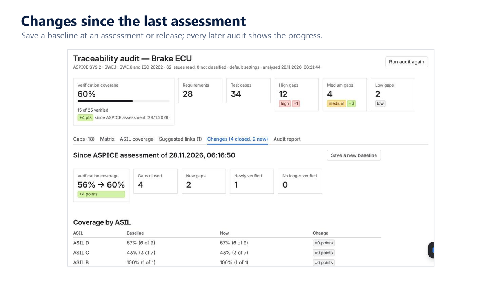
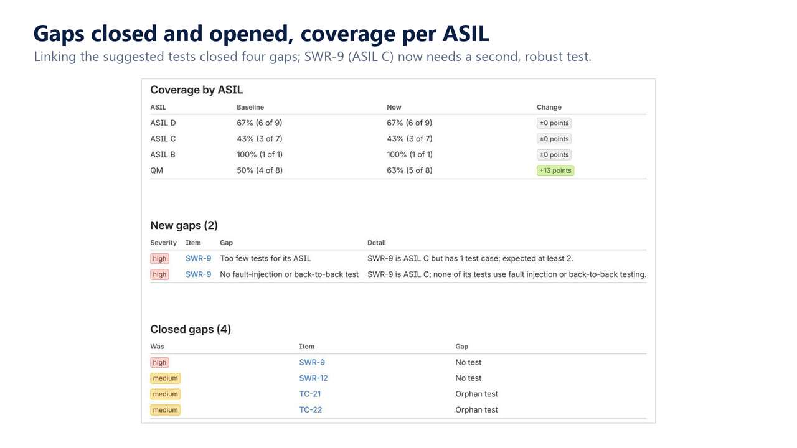
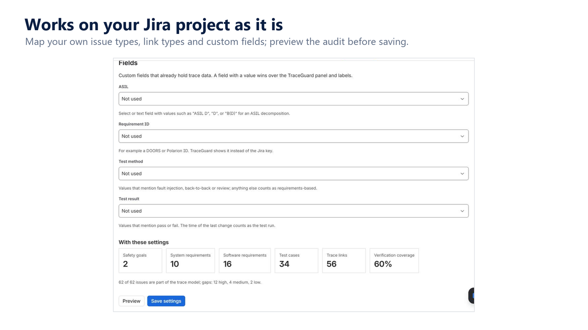
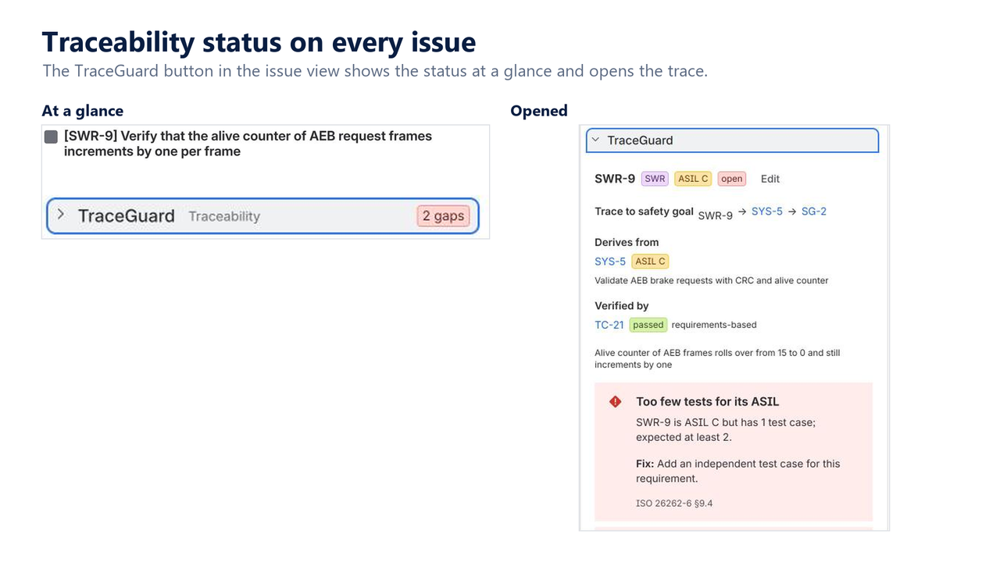

# TraceGuard — ASPICE and ISO 26262 traceability for Jira and Confluence

TraceGuard audits the requirements traceability of automotive software projects where the work already lives: in Jira.
It reads safety goals, system and software requirements and test cases, checks them against
Automotive SPICE (SYS.2, SWE.1, SWE.6) and ISO 26262 (parts 3, 6, 8 and 9), and shows what an assessor would find,
long before the assessment.

Built on Atlassian Forge for Codegeist 2026. Runs on Atlassian: no external services, no data leaves your site.

**[Watch the demo video (2:40)](https://youtu.be/bkkk_oMemOg)**

[](https://github.com/librevlad/traceguard/actions/workflows/test.yml)

## Install

**[Install TraceGuard on your Atlassian site](https://developer.atlassian.com/console/install/0f49570e-2b19-40cf-ad9c-e04bf8b374bb?signature=AYABeGxS%2FqfHOPdmC0TDZmoyklAAAAADAAdhd3Mta21zAEthcm46YXdzOmttczp1cy13ZXN0LTI6NzA5NTg3ODM1MjQzOmtleS83MDVlZDY3MC1mNTdjLTQxYjUtOWY5Yi1lM2YyZGNjMTQ2ZTcAuAECAQB4CxqLTo9l4lqXuFjNim1xJM%2Bp%2F3TVP9xHS2BrU5DRRucBQK0r6uPvULb79FS8bit11wAAAH4wfAYJKoZIhvcNAQcGoG8wbQIBADBoBgkqhkiG9w0BBwEwHgYJYIZIAWUDBAEuMBEEDE2GnQDyYC1dZP7RQgIBEIA7QPo1NVhn8yN%2FLqaXk4iPvPKb13jFu4lsx98HiNMwNWYyH2PECkK7Y1selp7SDezLc%2BRoEClxGQNFK94AB2F3cy1rbXMAS2Fybjphd3M6a21zOmV1LXdlc3QtMTo3MDk1ODc4MzUyNDM6a2V5LzQ2MzBjZTZiLTAwYzMtNGRlMi04NzdiLTYyN2UyMDYwZTVjYwC4AQICAHi9bVMAkme4qVQX1fQHo6ePw3H40A7cGfz7yrmSfBWMXgFAqMgDcui5N1bGy90KRQyLAAAAfjB8BgkqhkiG9w0BBwagbzBtAgEAMGgGCSqGSIb3DQEHATAeBglghkgBZQMEAS4wEQQMKttTg9z%2FeBohSvXOAgEQgDtAJPlw2CB2TLpPxkrTn%2FqjAWb3A7lNlxdJtbJ1LRRdfI%2F%2BenviW9WvOMAWngbScQ4ABU0qVr%2FSU38JTgAHYXdzLWttcwBLYXJuOmF3czprbXM6dXMtZWFzdC0xOjcwOTU4NzgzNTI0MzprZXkvNmMxMjBiYTAtNGNkNS00OTg1LWI4MmUtNDBhMDQ5NTJjYzU3ALgBAgIAeDYASx0XCjkny4iLV6vz%2BKtEGSGT6kdt0QRpkn6D%2FlVEAeLqHaOv27%2BBDJrOssfq%2BvMAAAB%2BMHwGCSqGSIb3DQEHBqBvMG0CAQAwaAYJKoZIhvcNAQcBMB4GCWCGSAFlAwQBLjARBAyixYgZgqtDjz5dnf8CARCAO6zPp2e9lb9a5TUhwMXQJUbYhWHeRr2qmE9mVbBbABMY3KZhYCnNdhVC2NA5AJwFoEmlj0rNrD8F0yv2AgAAAAAMAAAQAAAAAAAAAAAAAAAAAC8u5qB1SCYoLK7pkTgs%2Byb%2F%2F%2F%2F%2FAAAAAQAAAAAAAAAAAAAAAQAAADLdYWRx4u6MAqmiaGM6jwi3pT049Rf%2Bs5kkzGSX0fmHdaE41jRMwkWMOaMARkX8xaoqZbimfO5Mu0OwhnOuO02Jed4%3D&product=jira&product=confluence)** — Jira and Confluence, Atlassian Cloud.
You need to be a site admin. Then open any Jira project, choose **TraceGuard audit** in the project tabs (under *More*),
and select **Load the brake ECU demo** to see a full audit in a minute.

## What it does

| Where | What |
|---|---|
| Jira issue view | A **Traceability** button on every issue with its status at a glance (*2 gaps*, *verified*, *failed*); it opens the trace. The same trace is also available as an issue panel. |
| Trace of one item | The chain up to its safety goal, the effective ASIL (with inheritance), verifying tests and their results, gaps with fixes, suggested links that you create with one click, and recording a test result. It refreshes when the issue is edited. |
| Jira project page | The full audit: verification coverage overall and per ASIL, every gap with severity, fix and standard reference, the traceability matrix, suggested links, changes since the last baseline, and an audit report published to Confluence. |
| Baselines | Save the audit at an assessment or a release. Every later audit shows coverage per ASIL before and now, gaps closed and opened, requirements newly verified or no longer verified, and the coverage trend across baselines. |
| Project settings | Map the project's own issue types, link types and custom fields (ASIL, requirement ID, test method, test result) to the trace model, with a preview of the audit before saving. |
| Confluence macro | A live matrix, gap list or ASIL coverage of a Jira project inside specs, safety cases and audit pages. |
| Rovo agent "Traceability Auditor" | Answers questions such as "which ASIL D requirements are not verified?" or "what changed since the last assessment?", explains gaps, proposes links and creates them after you confirm, and publishes the report. |
| MCP server (`rovo:mcp`) | The same nine tools for external agents such as Claude Code or Cursor. |






## Rules

| Rule | Checks | Reference |
|---|---|---|
| not-broken-down | safety goal or software-allocated system requirement without derived requirements | ASPICE SYS.2 BP6 / SWE.1 BP6 |
| orphan-requirement | software requirement without a parent | ASPICE SWE.1 BP6 |
| not-verified | requirement without a test case | ASPICE SWE.6 BP5 / SYS.5 BP5 |
| insufficient-verification | ASIL C/D with fewer than two tests, or no fault-injection or back-to-back test | ISO 26262-6 §9.4, Table 7 |
| failing-verification | failing or never-executed tests | ASPICE SWE.6 BP3 |
| suspect-link | requirement text changed after its tests last ran | ISO 26262-8 §8 |
| asil-downgrade | ASIL lower than the parent without a documented ASIL decomposition | ISO 26262-9 §5 |
| missing-asil | requirement below a safety goal without an ASIL | ISO 26262-3 §7 |
| orphan-test / broken-link | test that verifies nothing, or points to a missing requirement | ASPICE SWE.6 BP5, SUP.10 |

Link suggestions use TF-IDF similarity of summaries and descriptions, so they work without an LLM and without sending data anywhere.
Every suggestion is a proposal: a person confirms it before it becomes a link.

## How the trace model is read from Jira

TraceGuard works on a project as it is. The **TraceGuard** page in the project settings maps the project's own
issue types, link types and custom fields; without settings, the defaults below apply.

- **Level**: the issue property `traceguard`, set from the TraceGuard panel; labels (`tg-sg`, `tg-sys`, `tg-swr`,
  `tg-test`); the issue type set in the project settings; or an issue type named Safety Goal, System Requirement,
  Software Requirement or Test.
- **ASIL, requirement ID, test method and result**: the custom fields chosen in the settings when they have a value
  (an ASIL such as `B(D)` records an ASIL decomposition); otherwise the property and the labels (`asil-d`, `alloc-hw`);
  a test's workflow status named passed or failed counts as its result.
- **Links**: the link types set in the settings, or Jira issue links whose wording says derives or verifies (TraceGuard
  adds the link types *Derives* and *Verifies*; Xray-style "tests / is tested by" works too), the Jira parent field, and
  links stored in the property for references that are not Jira issues. Links are oriented by level, so a link created
  the wrong way round still reads correctly.
- **Requirement IDs**: the property `ref` or the requirement ID field (for example `SWR-3` or a DOORS id) is shown
  instead of the Jira key.
- **Suspect links**: the last edit of summary or description, compared with the last run of each test.

Settings and baselines are Jira project properties: every surface (Jira, Confluence, Rovo, MCP clients) reads the same
data, whichever product a call comes through, and Jira lets only project administrators change them.

## Try it

On the TraceGuard audit page of an empty Jira project, **Load the brake ECU demo** creates 62 issues of an
electronic brake control unit (2 safety goals, 10 system and 16 software requirements, 34 test cases) with
13 gaps left on purpose. Loading is safe to repeat.

## Repository

| Path | What |
|---|---|
| `traceguard/core` | The analysis engine: plain JavaScript, no dependencies, 31 tests (`node --test`): rules, the Jira mapping with project settings, baselines and reports. |
| `traceguard/demo` | The brake ECU demo project and a sample audit report. |
| `app` | The Forge app: manifest, Jira and Confluence UI (UI Kit), resolvers, Rovo actions and agent, MCP server. |

## Development

```
cd traceguard/core && node --test
cd ../../app
npm install
npm run sync-core          # copy the core and the demo into app/src
forge lint
forge deploy -e development
forge install --site <site>.atlassian.net --product jira -e development
forge install --site <site>.atlassian.net --product confluence -e development
```

External MCP clients connect to `https://mcp.atlassian.com/forge/0f49570e-2b19-40cf-ad9c-e04bf8b374bb` after a site admin
turns on "Expose tools to MCP-compatible apps" for TraceGuard in Atlassian Administration (Connected apps), for both the
Jira and the Confluence installation. For example, in Claude Code:

```
claude mcp add --transport http traceguard https://mcp.atlassian.com/forge/0f49570e-2b19-40cf-ad9c-e04bf8b374bb
claude mcp login traceguard
```

## Privacy and support

See [PRIVACY.md](PRIVACY.md) and [SUPPORT.md](SUPPORT.md).

## License

MIT, see [LICENSE](LICENSE).
